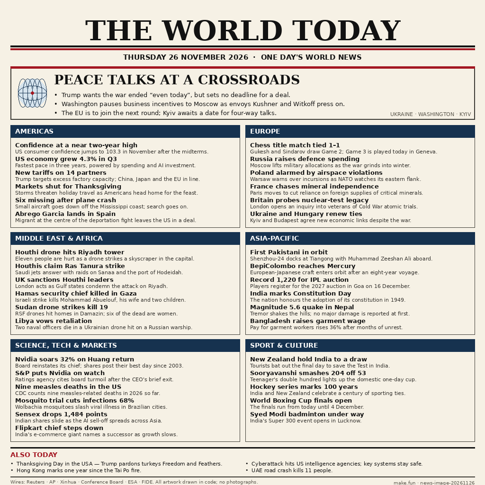

# THE WORLD TODAY — Thursday 26 November 2026

[](https://make.fun/bounty/news-image-20261126?utm_source=github&utm_medium=readme&utm_campaign=news-image-20261126)
[](https://make.fun/bounty/news-image-20261126/leaderboard?utm_source=github&utm_medium=readme&utm_campaign=news-image-20261126)
[](https://make.fun/bounty/news-image-20261126?utm_source=github&utm_medium=readme&utm_campaign=news-image-20261126)

Entry for the make.fun competition **news-image-20261126** — sum up
26 November's world news in one image ([bounty
page](https://make.fun/c/news-image-20261126)). The entry is one
1024×1024 PNG: the front page of a broadsheet, THE WORLD TODAY,
dated Thursday 26 November 2026 — a lead story on the Ukraine peace
talks, six regional sections carrying 35 stories, and an "Also
today" strip along the bottom.



## On the page

- **Lead — PEACE TALKS AT A CROSSROADS.** Trump wants the war
  ended "even today" but sets no deadline; Washington pauses business
  incentives to Moscow; the EU is to join the next round of talks.
- **Americas:** US consumer confidence jumps to 103.3, near a
  two-year high; Q3 GDP grew 4.3%; new tariffs on 14 partners;
  markets shut for Thanksgiving; six missing after a plane crash
  off Mississippi; Abrego Garcia lands in Spain.
- **Europe:** Gukesh and Sindarov tied 1–1, Game 3 of the chess
  title match today in Geneva; Russia raises defence spending;
  Poland alarmed by airspace violations; France chases mineral
  independence; Britain probes the nuclear-test legacy; Ukraine and
  Hungary renew economic ties.
- **Middle East & Africa:** a Houthi drone hits a Riyadh tower,
  11 hurt; Houthis claim a Ras Tanura strike as Saudi jets hit
  Sanaa and Hodeidah; the UK sanctions Houthi leaders; a Hamas
  security chief is killed in Gaza; Sudan drone strikes kill 19;
  Libya vows retaliation after two officers die.
- **Asia-Pacific:** the first Pakistani astronaut reaches Tiangong
  aboard Shenzhou-24; BepiColombo enters Mercury orbit; a record
  1,220 players register for the IPL auction; India marks
  Constitution Day; a magnitude 5.6 quake in Nepal; Bangladesh
  raises the garment wage 36%.
- **Science, tech & markets:** Nvidia soars 32% as its board
  reinstates Huang; S&P puts Nvidia on downgrade watch; nine
  measles deaths in the US; a mosquito trial cuts Brazil's viral
  infections 68%; the Sensex drops 1,484 points; Flipkart's chief
  steps down.
- **Sport & culture:** New Zealand hold India to a draw;
  Sooryavanshi smashes 204 off 53 balls; India–New Zealand hockey
  marks 100 years; the World Boxing Cup finals open; Syed Modi
  badminton under way.
- **Also today:** Thanksgiving Day in the USA, with Trump pardoning
  turkeys Freedom and Feathers; Hong Kong marks one year since the
  Tai Po fire; a cyberattack hits US intelligence agencies; a UAE
  road crash kills 11.

Wire sources credited on the page: Reuters, AP, Xinhua, Conference
Board, ESA, FIDE. All artwork on the page — masthead, globe, section
art — was drawn in code for this entry; no photographs are used.

## Running the entry

```sh
python3 main.py
```

`main.py` is standard-library only and runs on a bare Python 3.13
container with nothing installed. It verifies the committed
`entry.png` (PNG signature, IHDR dimensions of 1024×1024, trailing
IEND chunk, size and SHA-256), copies it into `$MAKEFUN_OUTPUT_DIR`
(default `/output`) through a staging file so the result is never
half-written, and re-verifies the copy before reporting success. No
network, no clock, no randomness: the output is byte-identical to
the artwork in this repository on every run, and any failed check
makes the entrypoint exit non-zero instead of delivering a broken
file.

`draw_frontpage.py` draws `entry.png` from scratch with Pillow
(fixed palette, fixed fonts, no randomness) and is kept in the
repository so the artwork can be regenerated exactly.

## License

MIT — see [LICENSE](LICENSE).
